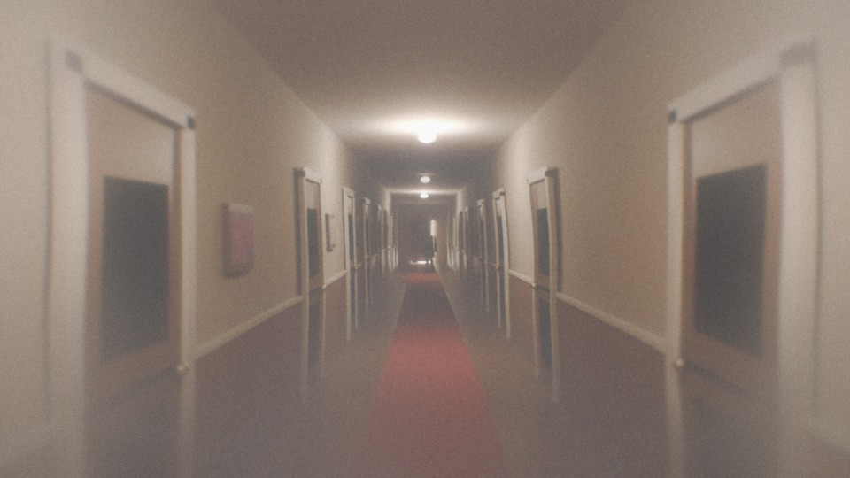
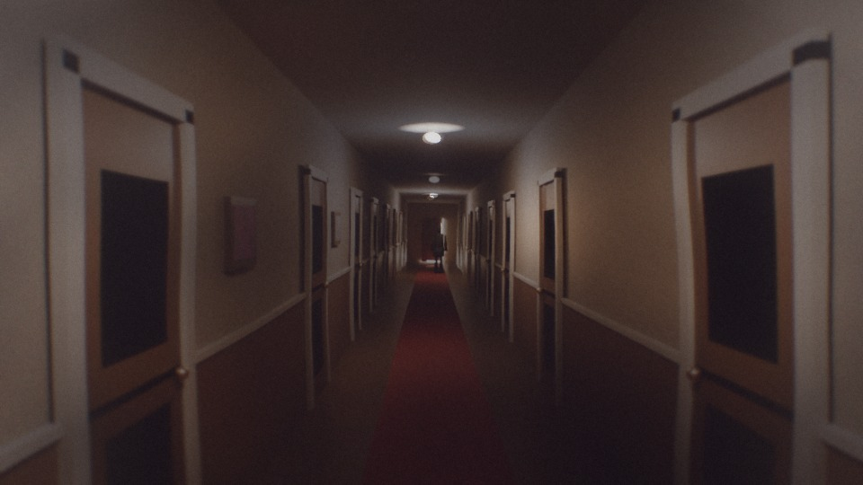
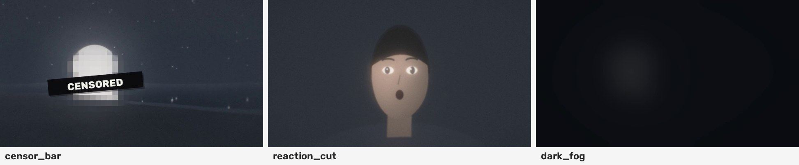
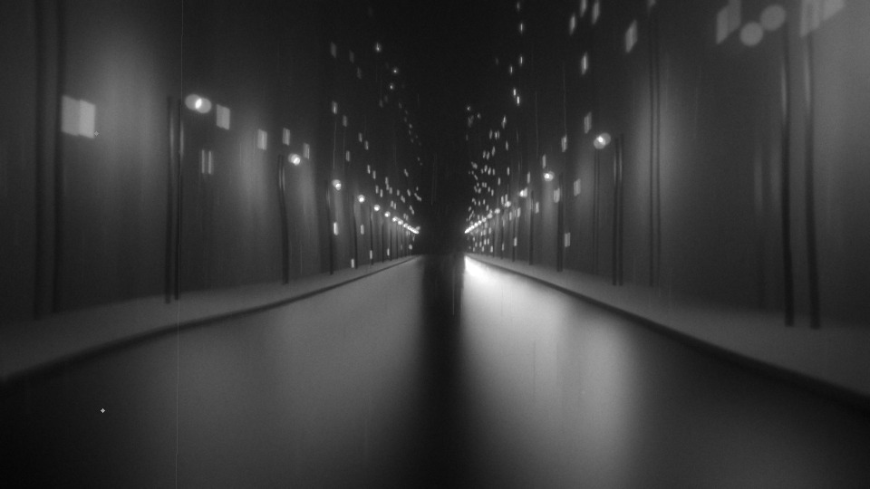

# Night Reels

Tell Night Reels a dream, typed or spoken, and it gives the dream back as a short, fog-veiled,
low-framerate reel that looks the way dreams feel: pseudo-realistic, half-remembered, sharp only
where your attention was.


**Try it:** https://djgraver.github.io/night-reels/ (the app, served from `index.html` by GitHub Pages)

**Live prototypes**

| | |
|---|---|
| App (dream journal + spec + fog preview) | https://claude.ai/artifact/JSmmCYLojSJEiU1LJdtdC7 |
| Reel (rendered example dreams, review page) | https://claude.ai/artifact/QoCHGXEDmG7smUAy9FYo4o |
| Atlas (dream-look research report) | https://claude.ai/artifact/RC5rDxfZ1FCWftMbTuckbX |

Current version: **v2** (see [`CHANGELOG.md`](CHANGELOG.md)).

## How it fits together

```
 you, half awake ──► index.html (app)  ──► dream spec v1 (JSON) ──► render/ pipeline ──► reel (mp4 + poster)
                     type or speak            look, scenes, people,     rate → mitigate → scenes →
                     People panel             content_rating            dream fog → low-fps clip
```

| Folder | What's in it |
|---|---|
| [`index.html`](index.html) | The app: one self-contained HTML page (journal, voice dictation, People panel, spec builder, canvas fog preview). GitHub Pages serves it at the repo's Pages URL. |
| [`renders/`](renders) | Pre-rendered clips for the app's three example dreams, listed in `renders/index.json`. |
| [`docs/`](docs) | [`dream-spec.md`](docs/dream-spec.md), the app → renderer hand-off format, and example images. |
| [`render/`](render) | The `dreamrender` Python pipeline: parsing, content rating, Blender scenes, stylizer, clip assembly, faces prototype, job server. Its own [README](render/README.md) has the detail. |
| [`research/`](research) | The reference dream-look renderer from the research report (the origin of the clarity dial). |

## The clarity / fog model

One number does most of the work: **fog**, 0 to 1 (the research report calls its inverse *clarity*).

* It comes from the dreamer's own words. A typical dream sits around 0.55. "Crystal clear", "vivid",
  "like real life" pull it down toward 0.08. "Hazy", "blurry", "I can't really remember" push it up to 0.9.
  Lucid dreams render brighter, clearer and more saturated. Negations are understood ("it wasn't foggy").
* Fog then sets everything else: depth fog distance, soft focus and periphery blur, glow and halation,
  slow warp, desaturation, grain, echo trails, and the frame rate (clear dreams play at about 12 fps,
  typical dreams at 8, foggy ones lower, with irregular holds).
* The thing the dream is *about* keeps an **attention island**: the subject stays readable while the edges
  dissolve into fog.
* **Fog tone**, 0 to 1: pale milky fog (0), fog in the scene's own colour (0.5), or black smoke (1).
  Picked from the mood: dread, darkness and being chased go dark; calm and warm go pale.
* **Fog can change mid-dream.** The dream is split into beats ("then", "suddenly", new sentences) and each
  beat gets its own fog and tone; "it went dark" or "the fog lifted" forces the turn. The clip eases between beats.
* **Styles are honoured only when the dreamer names them**: mono, noir, sepia, VHS, vivid, pastel, plus colour
  tints ("everything was purple"). Otherwise the look stays natural and photographic.

Every value is calibrated by eye so far and is meant to be tuned from tests with real dreamers.

<p>


</p>

## Content rating

Dreams can be anything, so every spec is rated before anything is drawn. Rules
([`render/CONTENT_POLICY.md`](render/CONTENT_POLICY.md), code in
[`render/dreamrender/rating.py`](render/dreamrender/rating.py) and
[`mitigate.py`](render/dreamrender/mitigate.py)):

* **Target: M** (Australian classification).
* **Sex** renders up to bikini / men's-magazine level. Anything beyond that, including all nudity, gets a comical **censor bar**.
* **Violence** renders up to action-movie level. Blood, wounds, gore or worse **cut to the dreamer's reaction face** (or get a censor bar).
* **Children**: any dream with someone under 18 in it (or the dreamer as a child) is capped at **PG**. Any explicit or
  allusive sexual or violent content involving a child **aborts the whole render**.
* **Never judge the dreamer.** An abort shows a gentle message and the journal entry is left untouched.
* Heavy themes get dark fog; self-harm fades to fog with a support line; strong language is softened in titles.
* An uploaded photo likeness never appears in sexual or violent-victim content (swapped for a generic face),
  is used only with consent, and photos of under-18s are never accepted.
* Claude classifies, code decides: the offline word-list rater is a floor the model can't lower.



## Running things

### The app

Open https://djgraver.github.io/night-reels/, or serve the repo root locally (`python3 -m http.server`) and open `index.html`. Voice dictation
and the optional Claude close-read need the claude.ai artifact runtime; without it the page still parses typed
dreams locally and shows the canvas fog preview. Real clips are picked up from `renders/index.json` beside the page (the three examples ship with the repo),
or from a render server set as `PipelineRenderer.endpoint` (see "RENDERER SEAM" in the page source).

### The render pipeline

```sh
cd render
pip install -r requirements.txt             # plus ffmpeg on PATH; bpy is Blender 5.3 from PyPI

# A dream from text, or from an app spec
python3 -m dreamrender.pipeline --text "I was in a hazy forest and there was a red door" --out out/mine
python3 -m dreamrender.pipeline --app-spec app_examples/d_1pyxr9f.json --out out/d_1pyxr9f

python3 render_examples.py                  # the example dreams -> out/<name>/
SKIP_RENDER=1 python3 render_examples.py    # re-stylize existing frames only (fast)
python3 render_tone.py                      # fog-tone examples
python3 build_page.py                       # review page -> site/index.html

# Content rating on its own, and the tests
python3 -m dreamrender.rating --text "I was naked on the beach" --rules-only
python3 -m pytest -q tests

# Job server for the app: POST /jobs (spec) -> poll GET /jobs/<id>
python3 -m dreamrender.serve --port 8787
```

Rendering is CPU Cycles: roughly 15 to 40 s per 960×540 frame, so 5 to 10 minutes per clip. The stylizer itself
is near real time. Set `ANTHROPIC_API_KEY` to use the Claude rater; without it the rules rater runs alone.

**Faces prototype** (optional): `sh fetch_face_models.sh`, `apt-get install -y libegl1 libgles2`,
`pip install mediapipe scikit-image onnxruntime`, then `python3 faces_demo.py --photo me.jpg --scene hallway --out out/faces`.
The InsightFace model it downloads is licensed for non-commercial research only and is used purely as a QA metric.

Outputs (`render/out/`), the generated review page (`render/site/`) and face models (`render/models/`) are not
committed; the scripts above regenerate them.

## What's a stand-in

The procedural Blender scenes are placeholders: the build box had no GPU and no image or video model. The spec,
the content rating, the fog stylizer and the clip assembly are meant to stay. Production swaps the base imagery for a
text-to-image / image-to-video model plus per-frame depth estimation, feeding the same `stylize()`.
Storage is intentionally out of scope until real-human tests.


